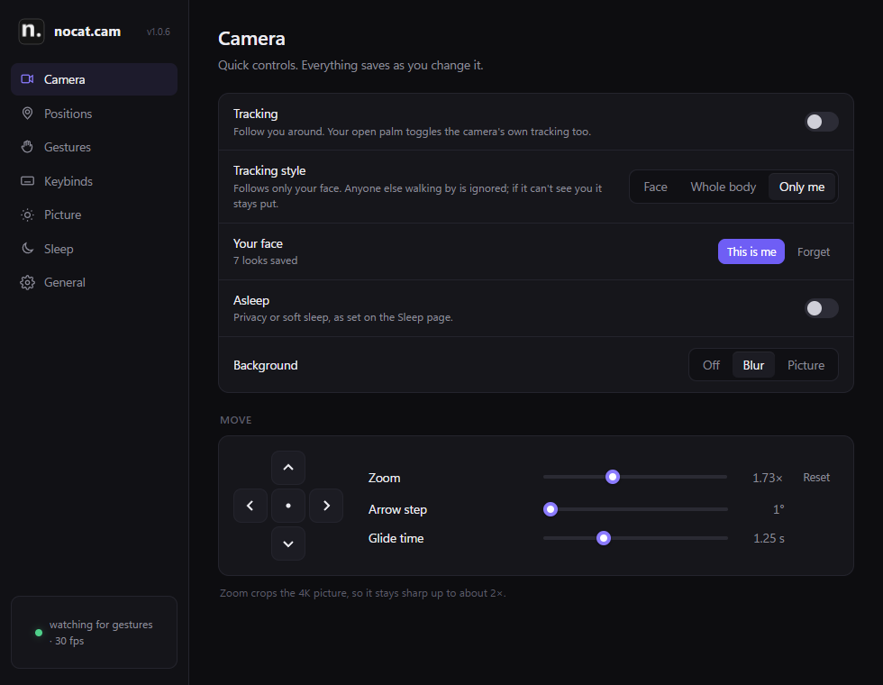
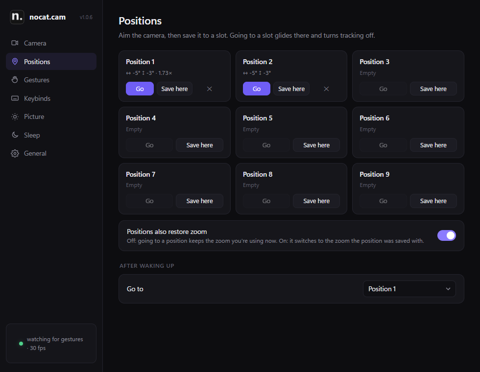
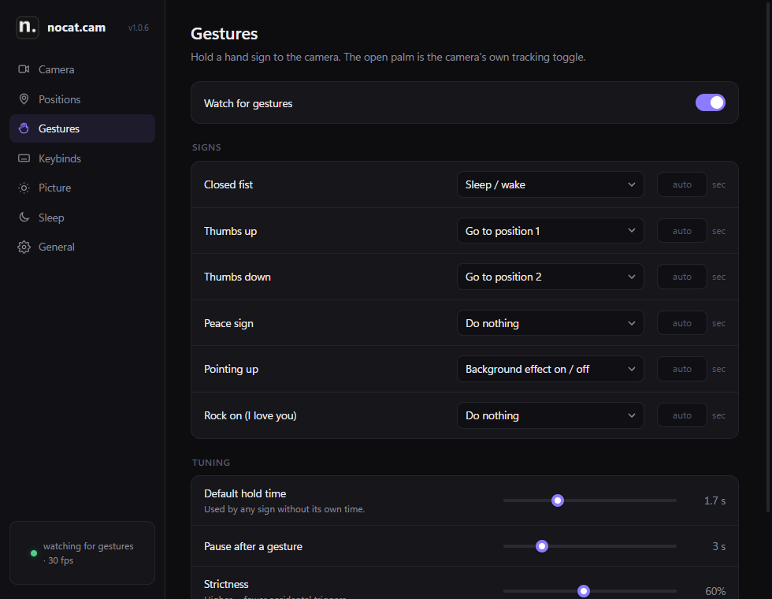
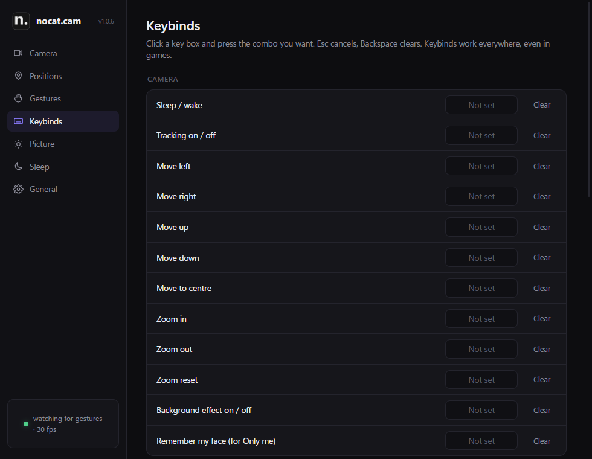
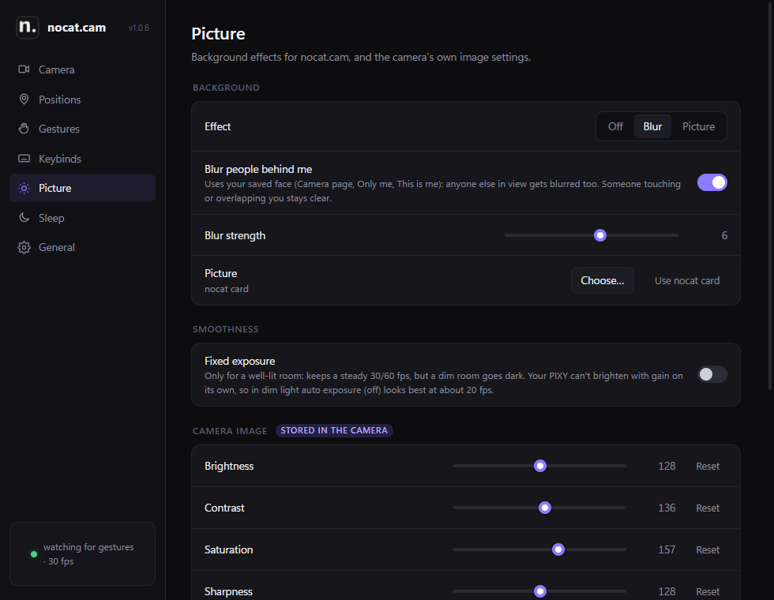
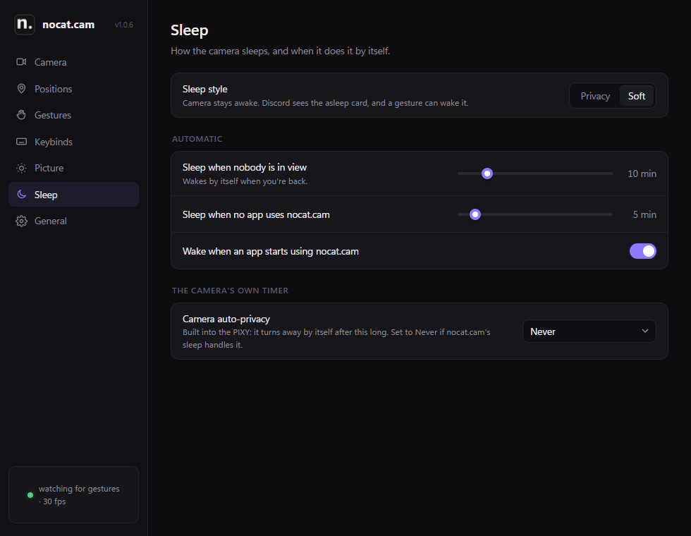
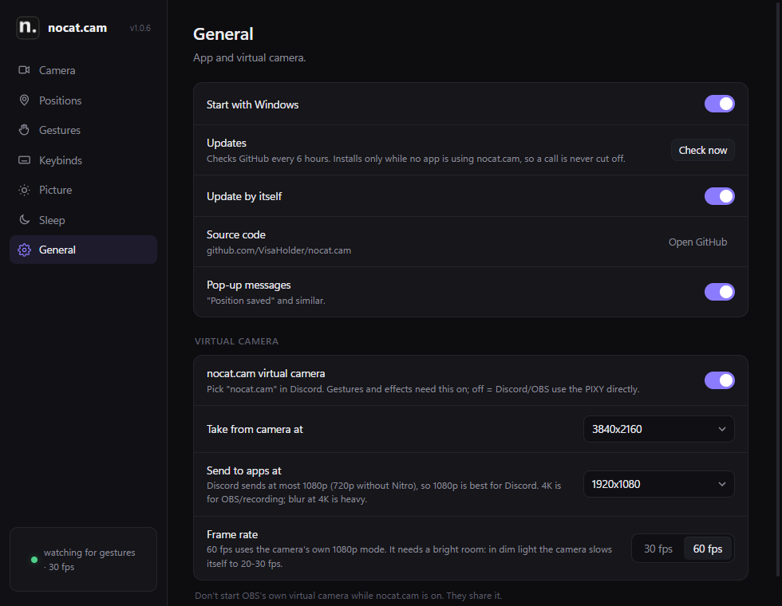

<p align="center">
  
</p>

<h1 align="center">nocat.cam</h1>

<p align="center">
  <b>Hand gestures, keybinds, saved positions, zoom and background blur for the EMEET PIXY webcam.<br>
  Discord, OBS and every other app see it through its own nocat.cam virtual camera.</b>
</p>

<p align="center">
  <a href="https://github.com/VisaHolder/nocat.cam/releases/latest"></a>
  <a href="LICENSE"></a>
  
</p>

<p align="center">
  <a href="https://github.com/VisaHolder/nocat.cam/releases/latest"><b>Download</b></a> ·
  <a href="#setup">Setup</a> ·
  <a href="#screenshots">Screenshots</a>
</p>

## Download and install

Get `nocat.cam-v…-portable.zip` from the [latest release](https://github.com/VisaHolder/nocat.cam/releases/latest),
right-click it, *Extract All…*, and run `nocat.cam.exe`. Nothing else needs installing first, not even .NET; see
[Setup](#setup) for the one-time virtual camera step. It updates itself after that.

Works with the PIXY 4K and the PIXY 2K. EMEET Studio isn't needed.

## What it does

- **Gestures** (Google MediaPipe): closed fist, thumbs up/down, peace sign, pointing up and rock-on can each
  trigger any action, with their own hold time. Open palm stays the camera's own tracking toggle.
- **Keybinds** for everything (any combo; defaults: `Alt+1`–`Alt+9` go to a position, `Alt+Shift+1`–`9`
  save one, `Alt+0` sleep/wake). They use Windows' own hotkeys, so nothing watches your keyboard.
- **Only me tracking**: nocat.cam steers the camera itself and follows only *your* face (press *This is me*
  a few times). Anyone walking behind you is ignored, and faces it sees next to yours are learned as "not me".
  Crouching or ducking doesn't lose you. *Whole body* follows anyone's full outline instead.
- **Positions**: nine slots that remember aim *and* zoom, with a smooth eased glide between them.
- **Zoom**: crops the 4K picture, so it stays sharp up to about 2×.
- **Background**: blur, or any picture, cut out around you. With your face saved, other people in view get
  blurred too.
- **Sleep**: *privacy* (camera turns away and is released, so its in-use light goes off) or *soft*
  (camera stays on, apps see a "camera asleep" card, and a gesture can wake it). Optional auto-sleep
  when nobody is in view or no app is using nocat.cam, and auto-wake when an app starts using it. When no app is
  using nocat.cam the camera can go all the way down (privacy) even from a soft sleep, and comes back up when one does.
- **Picture**: brightness, contrast, white balance, exposure, focus and more, plus a *Fixed exposure* switch for bright rooms
  (in dim rooms auto exposure slows the camera).
- **Light on resources**: the camera's MJPEG pictures are read through DirectShow and decoded by libjpeg-turbo
  straight to the size being sent (4K to 1080p while decoding), then stay NV12 to the virtual camera. When no
  app shows nocat.cam it only sends 2 pictures a second. About 1-2% CPU on a Ryzen 9800X3D.
- **Updates** from GitHub releases: *Check now* in settings, or by itself every 6 hours (only while no app
  is using nocat.cam, so a call is never cut off). Each version gets its own folder; the old one stays as a backup.
- **PIXY 2K**: works the same; sizes above 1440p are hidden since that camera tops out at 2560x1440@30 and 1080p@60.
- **Frame rate**: 1080p/720p up to 60 fps (the camera's 1080p mode), 1440p/4K 30. In dim light the PIXY slows
  itself down (1080p mode 60 -> 30, 4K mode 30 -> 20), so for Discord 1080p at 60 is the smoothest choice.

## Screenshots

| | |
|---|---|
|  |  |
|  |  |
|  |  |

## Setup

1. Install [OBS Studio](https://obsproject.com/) once. nocat.cam uses its virtual camera driver. OBS
   itself doesn't need to run, and you shouldn't start OBS's own virtual camera while nocat.cam is on.
2. Run `nocat.cam.exe`. It goes to the tray; click the icon for settings.
3. Optional: right-click `tools\rename-vcam.ps1` → *Run with PowerShell* as admin, so apps list the camera as
   **nocat.cam** instead of "OBS Virtual Camera". `-Undo` puts it back.
4. In Discord (or anywhere), pick **nocat.cam** as your camera.

Settings live in `%APPDATA%\nocat.cam\config.json`, the log next to it. To move settings, drop a
`config.json` next to the exe renamed to `import-config.json`; it's imported on the next start.

## Building

```powershell
powershell -ExecutionPolicy Bypass -File tools\get-mediapipe.ps1   # fetches libmediapipe.dll (68 MB) from PyPI
powershell -ExecutionPolicy Bypass -File tools\get-turbojpeg.ps1   # fetches turbojpeg.dll from the official libjpeg-turbo release
dotnet build -c Release
dotnet publish -c Release -o publish
```

`nocat.cam.exe --selftest result.txt` checks the camera, USB control, capture speed, AI models, picture
controls and virtual camera without opening any windows.

## How the PIXY is controlled

EMEET doesn't document it. The commands were worked out by logging what EMEET Studio sends over the
camera's HID interface (VID 328F, PID 00C0, report 0x09):

| what | bytes |
|---|---|
| set mode | `09 01 01 00  00 01 00 01  <mode>` (0 manual, 1 tracking, 2 privacy) |
| get mode | `09 01 01 01` |
| move | `09 63 01 00  00 05 00 05  <axis> <float32 degrees>` (axis 1 pan, 2 tilt) |
| where is it | `09 63 01 01  00 01 00 01  <axis>` → axis, target, actual |

## Credits

- [MediaPipe](https://github.com/google-ai-edge/mediapipe) (Google, Apache 2.0): `libmediapipe.dll`, the
  gesture recogniser, selfie segmenter, face detector and image embedder models in `models\`.
- [libjpeg-turbo](https://libjpeg-turbo.org/) (BSD/IJG): `turbojpeg.dll`.
- [HidSharp](https://www.zer7.com/software/hidsharp) (Apache 2.0),
  [Microsoft WebView2](https://developer.microsoft.com/microsoft-edge/webview2/).
- The virtual camera driver is [OBS Studio](https://obsproject.com/)'s (GPL 2.0), used as installed; nocat.cam only writes pictures to it.

## Licence

nocat.cam is under the [Mozilla Public License 2.0](LICENSE). The parts listed in Credits keep their own licences.
